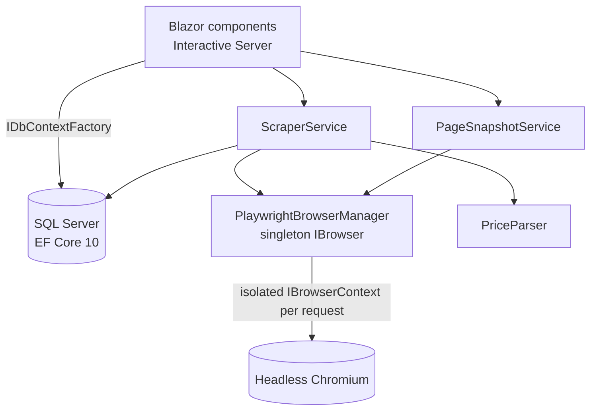
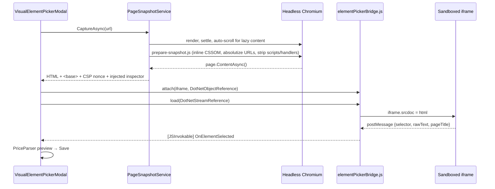

# Sarium — Project Tasks & Self-Learning Price Tracker

A Blazor Web App (Interactive Server, .NET 10) for planning projects with todo checklists and wishlists whose prices are tracked automatically by a headless Playwright scraper. When the scraper can't find a price on a site it hasn't seen before, you teach it through a **visual element picker**: a sanitized, script-free snapshot of the product page loads in a sandboxed iframe, you click the price, and the generated CSS selector is saved as a reusable rule for that domain.

## Features

- **Projects and a general workspace.** Each project has a todo checklist (priorities, due dates, overdue tracking) and a product wishlist with a target budget. Tasks and items without a project live in the General Workspace (`/wishlist`).
- **Live total calculator.** Sums the items you include, grouped by currency, with price-drop indicators, savings, budget utilization and a **Refresh All Prices** run that reports progress per item and can be cancelled.
- **Self-learning scraper.** Each domain keeps a `DomainScrapeRule` with success/failure statistics. A selector found by the heuristics is learned automatically; selectors picked by hand replace it.
- **Visual iframe element picker.** Hover to inspect, click to select, use <kbd>↑</kbd>/<kbd>↓</kbd> to move to the parent or child element, edit the selector by hand, re-check it in the snapshot, and test it against the live page before saving.
- **Domain rules registry** (`/domain-rules`). Full CRUD over learned selectors, with reliability bars, inline editing, counter resets and per-domain re-checks.
- **Dashboard** covering active projects, pending and overdue tasks, combined wishlist total vs. budgets, upcoming tasks, recent price drops, and items that need attention.
- Light and dark themes built on Bootstrap 5 and Bootstrap Icons.

## Architecture



### Scraping pipeline

For each refresh, `ScraperService.RefreshItemAsync`:

1. Normalizes the product URL to a domain (`www.` stripped) with `DomainNormalizer`.
2. Builds a selector plan: the item's `CustomCssSelectorOverride` first, then the learned `DomainScrapeRule`.
3. Opens an isolated browser context (realistic desktop User-Agent, viewport, locale; images, media and fonts blocked), navigates with `DOMContentLoaded` plus a short network-idle settle, and reads each planned selector with `InnerTextAsync`, falling back to the `content` attribute.
4. If the plan fails, runs `detect-price.js` on the live page. It checks, in confidence order, JSON-LD `offers`, `product:price:amount` meta tags, `[itemprop="price"]`, known storefront selectors (`.a-price .a-offscreen`, `.price_color`, …), generic price classes, and finally visible `[class*="price"]` elements ranked by font size.
5. Persists the outcome. On success it updates `CurrentPrice` and `PreviousPrice` and atomically increments the rule's `SuccessCount`; a failed rule gets its `FailureCount` incremented. When nothing is confident enough, the item is set to `NeedsElementSelection` and the UI opens the visual picker.

`PriceParser` pulls a decimal amount and a currency symbol out of noisy strings such as `US$ 1,299.99`, `1.299,99 €`, `£45.00 incl. VAT` or `CHF 1'249.00`. It treats the last separator as the decimal mark when both `.` and `,` appear. With only one separator, a group of exactly three trailing digits (or repeated separators) means thousands grouping. If several numbers appear, the one closest to a currency token wins.

### Visual picker

Product pages can't be framed directly (`X-Frame-Options` and CSP `frame-ancestors`), so the picker uses a **DOM snapshot + `srcdoc`**:



Defense in depth for the snapshot:

- Executable markup is removed twice: once in the live DOM (`<script>`, `<noscript>`, `on*` attributes, `javascript:` URLs, meta refresh, nested frames) and again with a regex pass on the serialized HTML.
- A per-snapshot CSP `<meta>` allows only the inspector script, through a random nonce.
- The iframe uses `sandbox="allow-scripts"` without `allow-same-origin`, so the snapshot runs in an opaque origin and can't reach the app's DOM, cookies or storage.
- The bridge only accepts messages whose `event.source` is that iframe's `contentWindow`, and caps their sizes.
- The snapshot travels to the browser as a `DotNetStreamReference` rather than through a component attribute, so multi-megabyte pages never enter Blazor's render tree.

The inspector builds selectors that resist churn. It prefers unique non-generated ids, then test and automation attributes (`data-testid`, `data-qa`, `itemprop`, …), then stable class combinations, then a unique ancestor anchor joined with a descendant combinator, and only falls back to an `:nth-of-type` structural path last. Hash-like tokens (CSS modules, styled-components, emotion and similar) are filtered out.

### Concurrency

- Every component and service creates short-lived contexts with `IDbContextFactory<AppDbContext>`, so one DbContext is never shared across SignalR circuit events.
- `PlaywrightBrowserManager` initializes a single `IPlaywright`/`IBrowser` lazily behind a `SemaphoreSlim`, relaunches if the browser disconnects, and caps concurrent pages (`Scraper:MaxConcurrentPages`). Cancelling a request closes its browser context so in-flight Playwright calls abort quickly.
- Rule statistics are updated with `ExecuteUpdateAsync` (`SuccessCount = SuccessCount + 1`). Learning a new rule is a single `INSERT … WHERE NOT EXISTS` under `UPDLOCK, HOLDLOCK`, so parallel refreshes on the same domain neither race nor hit the unique index.

## Tech stack

| Concern | Choice |
| --- | --- |
| Runtime | .NET 10 (`net10.0`), C# latest |
| UI | Blazor Web App, global Interactive Server render mode, Bootstrap 5.3, Bootstrap Icons |
| Data | EF Core 10 + SQL Server (LocalDB by default), migrations applied on startup |
| Scraping | Microsoft.Playwright (headless Chromium) |
| Tests | xUnit |

## Getting started

### Prerequisites

- [.NET 10 SDK](https://dotnet.microsoft.com/download/dotnet/10.0)
- SQL Server LocalDB (installed with Visual Studio, or as a standalone installer) or any SQL Server instance
- PowerShell (`pwsh` or Windows PowerShell) to run the Playwright install script

### Run

```bash
git clone [<repository-url>](https://github.com/GomezSopar/SariumWish)
cd <repository-folder>
dotnet restore
dotnet build
pwsh src/PriceTrackerWorkspace/bin/Debug/net10.0/playwright.ps1 install chromium
dotnet run --project src/PriceTrackerWorkspace
```

Open http://localhost:5096. On first start the app applies the EF Core migrations, creating `PriceTrackerWorkspaceDb`, and seeds a sample project that tracks two books on [books.toscrape.com](https://books.toscrape.com), a public scraping sandbox. Click **Refresh All Prices** there to watch the scraper learn its first domain rule.

> The Playwright install step is optional: with `Scraper:AutoInstallBrowser` enabled (the default), the app downloads Chromium the first time it needs a browser.

### Configuration

The connection string lives in `ConnectionStrings:WorkspaceDb`. Scraper behaviour is bound from the `Scraper` section of `appsettings.json`:

| Key | Default | Purpose |
| --- | --- | --- |
| `UserAgent`, `Locale`, `TimezoneId` | desktop Chrome, `en-US`, `America/New_York` | Browser context fingerprint |
| `ViewportWidth` / `ViewportHeight` | `1440` / `900` | Rendered viewport |
| `BrowserChannel` | *(empty)* | Empty uses Playwright's headless shell; `chromium` uses the full build in new-headless mode |
| `Headless` | `true` | Set `false` to watch scrapes locally |
| `AutoInstallBrowser` | `true` | Install Chromium on first launch if it is missing |
| `MaxConcurrentPages` | `3` | Upper bound on parallel pages |
| `NavigationTimeoutMs` | `30000` | Page navigation timeout |
| `NetworkIdleSettleMs` | `4000` | Extra wait for network idle after `DOMContentLoaded` |
| `SelectorTimeoutMs` | `5000` | Wait for a selector to attach |

Set `Database:SeedSampleData` to `false` to start with an empty workspace.

## Project structure

```
src/PriceTrackerWorkspace
├── Components
│   ├── Layout            MainLayout, NavMenu, ThemeToggle, ReconnectModal
│   ├── Pages             Home, Projects, ProjectWorkspace, DomainRules
│   ├── Shared            VisualElementPickerModal, badges, display helpers
│   └── Workspace         TodoChecklist, WishlistPanel
├── Data                  AppDbContext, migrations, initializer, sample seeder
├── Domain                WorkspaceProject, TodoItem, WishlistItem, DomainScrapeRule
├── Scraping
│   ├── Scripts           detect-price.js, prepare-snapshot.js, element inspector (embedded)
│   ├── Snapshots         PageSnapshotService, SnapshotDocumentComposer
│   └── …                 PriceParser, PlaywrightBrowserManager, ScraperService
└── wwwroot/js            elementPickerBridge.js, theme.js
tests/PriceTrackerWorkspace.Tests
```

## Tests

```bash
dotnet test
```

The suite covers multi-locale price parsing, domain normalization, snapshot sanitization (script removal, `<base>`/CSP injection, nonce handling) and the wishlist price-history rules.

## Troubleshooting

- **`MSB3021` / path exceeds 260 characters on build.** The Playwright package copies deeply nested driver files into `bin/`. Clone the repository to a shorter path, or enable Windows long paths (`LongPathsEnabled`).
- **Browser fails to launch.** Leave `Scraper:BrowserChannel` empty to use Playwright's headless shell, and re-run the Playwright install command.
- **Cannot connect to LocalDB.** Run `sqllocaldb start mssqllocaldb`, or point `ConnectionStrings:WorkspaceDb` at another SQL Server instance.

## Known limitations

- Some large retailers detect headless browsers and serve challenge pages. The scraper reports the HTTP status, and the visual picker still works whenever a snapshot renders.
- Snapshots are static. Shadow DOM content and canvas drawings aren't serialized, and web fonts may not load inside the opaque-origin iframe because of CORS.
- A wishlist holding several currencies shows a separate total per currency. Budgets are compared against the dominant currency, without exchange rates.
